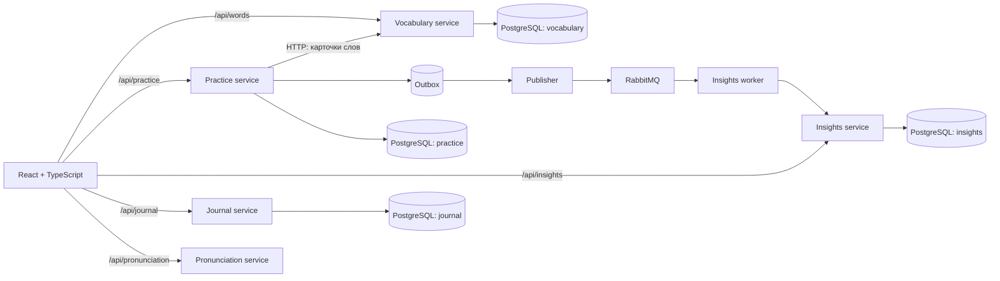

# Wordwell

Локальное приложение для изучения английских слов. Словарь пополняется вручную или JSON-файлом, тренировка предлагает перевод в обе стороны, а интервалы повторения зависят от ответов.

## Запуск

Нужны Docker с Compose и `make` (в WSL они уже доступны). Из корня репозитория:

```bash
cp .env.example .env
make up
```

`make up` поднимет PostgreSQL и RabbitMQ, соберёт образы, применит Alembic-миграции ко всем базам, запустит сервисы и дождётся их healthcheck. После успешного запуска команда напечатает фактический адрес фронтенда. По умолчанию это [http://localhost:8080](http://localhost:8080). Данные PostgreSQL сохраняются в Docker volume `postgres_data`.

При запуске проверяется резервная копия за последнее наступившее воскресенье, 12:00 по местному времени Windows. Если её нет, выполняется `pg_dump -Fc` для всех четырёх баз. Файлы, контрольные суммы и маркер завершения находятся в `D:\Архивы\Дампы\smart_learning\ГГГГММДД`. Windows Task Scheduler также запускает `scripts/Backup-Wordwell.ps1` каждое воскресенье в 12:00; пропущенный запуск восполняется при следующем `make up`. Старые копии автоматически не удаляются. Проверка задачи: `Get-ScheduledTask -TaskName 'Wordwell Weekly Backup'` в PowerShell.

Для остановки: `make down`. Эта команда сохраняет слова и дневные записи. В Windows можно запустить `Wordwell.bat` на рабочем столе: меню запускает сайт с миграциями или останавливает контейнеры. Исходник меню лежит в `scripts/wordwell-menu.bat`. `docker compose down -v` **удалит** базы; перед этим сохрани важные данные.

Дополнительные адреса только на этом компьютере: Swagger словаря — `http://localhost:8001/docs`, тренировок — `http://localhost:8002/docs`, статистики — `http://localhost:8003/docs`, дневных записей — `http://localhost:8004/docs`; RabbitMQ UI — `http://localhost:15672` (учётные данные из `.env`).

## Как добавить слова

1. Скопируй [промпт](frontend/public/word-prompt.md), вставь в него список слов и отправь любой выбранной тобой нейросети. Само приложение к нейросети не подключается.
2. Сохрани полученный ответ в UTF-8 файл с расширением `.json`.
3. Открой «Импорт слов» в приложении и загрузи файл. [Пример файла](frontend/public/example-words.json) можно импортировать для проверки.

Корень файла — массив объектов или объект `{"words": [...]}`. Обязательные поля каждого слова: `english` и непустой массив `translations`. Необязательные: `examples` (`en`/`ru`), `part_of_speech`, `note`, `tags`. Повторный импорт слова с тем же английским написанием обновляет его карточку. Импорт целиком проверяется перед записью; частично корректные файлы не создают частичный словарь. Лимит — 20 МБ и 10 000 слов за раз.

## Мой день

Раздел «Мой день» ведёт через мысли, английский, спорт и итог. Все поля содержания необязательны. Количество разных слов, повторённых сегодня, можно подставить из практики. Изменения в незавершённой форме сохраняются в `localStorage` браузера; завершённая запись сохраняется в PostgreSQL сервиса Journal. Черновик предлагается продолжить на главной в день создания и на следующий день. Напоминание можно отложить на два часа. После 20:00 по местному времени браузера главная предлагает создать запись за сегодня.

Статистика «сегодня», график дней и серия занятий рассчитываются по часовому поясу браузера (IANA), который передаётся в API. События хранятся с временем UTC. Запись отчёта содержит часовой пояс, в котором указан день. Если один и тот же сервер используется несколькими людьми, текущая версия всё ещё не разделяет данные по аккаунтам; для раздельных личных словарей и дневников нужны отдельные установки или будущая авторизация.

В словаре также можно добавлять, менять и удалять слова вручную, редактировать несколько примеров, выставлять степень изученности отдельно для двух направлений и скачивать JSON для резервной копии.

В практике сначала выбирается случайная подборка указанного размера. Когда все её карточки отложены до следующего повтора, можно добавить ещё слова в текущую подборку. Новая подборка доступна, когда все слова текущей дошли до уровня 3 в обоих направлениях (интервал 3 дня). Старые слова возвращаются в выдачу при наступлении срока повтора. После ответа можно признать свой вариант верным, исправить словарную карточку с автоматической переоценкой или удалить ошибочное слово вместе с его результатами. Словарь загружается страницами по 24 слова; поиск выполняется на сервере.

### Произношение

Для существующего словаря созданы локальные WAV-файлы американским голосом Windows `Microsoft Zira Desktop`. Кнопка `US` воспроизводит локальный файл. Для нового слова без файла браузер использует доступный голос `en-US`. После добавления слов файлы можно обновить командой `make audio`.

Отдельный сервис `pronunciation` сначала отдаёт лицензированную человеческую запись, если она найдена в Wiktionary/Wikimedia Commons, и показывает автора и лицензию рядом с кнопкой. `scripts/sync_pronunciations.py` проверяет английскую секцию Wiktionary и лицензию конкретного файла Commons, сохраняет данные в `data/pronunciation` и умеет продолжать после перерыва. Проверка без скачивания: `python3 scripts/sync_pronunciations.py --catalog-only --limit 20`; осторожная загрузка: `python3 scripts/sync_pronunciations.py --limit 20`. При HTTP 429 скрипт прекращает запросы; запускать снова следует позже. Записи Cambridge массово не копируются: Cambridge лицензирует аудиоданные отдельно.

## Архитектура



Каждый сервис владеет своей базой, хотя все четыре базы работают в одном контейнере PostgreSQL. Миграция `shared/alembic/bootstrap` создаёт базы, а миграции внутри каждого сервиса создают таблицы. Старые локальные базы первого MVP миграции принимают без удаления таблиц и данных. Практика получает карточки слов через API словаря и синхронно сохраняет результат и текущий уровень. Событие ответа записывается в outbox в той же транзакции, затем отдельный publisher доставляет его в RabbitMQ. Worker статистики обрабатывает версии события с защитой от дубликатов, поэтому исправленные и удалённые ответы пересчитываются и там. Статистика на главной странице может обновиться с небольшой задержкой.

В каждом `services/<name>/src` HTTP-маршруты лежат в `api`, предметная логика — в `services`, доступ к собственной базе — в `repositories`, таблицы — в `models.py`, входные и выходные схемы — в Pydantic-моделях. В `shared` находятся общие настройки, контракты событий и слов, обработка ошибок, соединения с БД и RabbitMQ. У фронтенда отдельные папки для страниц, компонентов, API и стилей.

Текущий алгоритм: для каждого слова отдельно хранятся уровни EN→RU и RU→EN. Верный ответ повышает уровень (до 6) и назначает повторение через 1, 3, 7, 14, 30 или 60 дней. Ошибка сбрасывает уровень и делает карточку доступной сразу. В выдачу попадают доступные карточки текущей подборки и просроченные повторы старых подборок; новые и просроченные карточки получают больший вес. Сравнение ответа игнорирует регистр, пунктуацию и разницу «е/ё». Для свободных формулировок есть ручная кнопка признания ответа верным.

## API

| Сервис | Основные ручки |
| --- | --- |
| Vocabulary | `GET/POST /words`, `GET/PUT/DELETE /words/{id}`, `POST /words/import` (multipart file), `GET /words/export` |
| Practice | `GET/POST /practice/cohort`, `GET /practice/next?direction=en_ru\|ru_en`, `POST /practice/answer`, `POST /practice/attempts/{id}/accept`, `POST /practice/attempts/{id}/recheck`, `DELETE /practice/words/{id}`, `GET /practice/progress`, `PUT /practice/progress/{word_id}`, `GET /practice/summary` |
| Insights | `GET /insights/summary` |
| Journal | `GET /journal/reports`, `GET/PUT /journal/reports/{date}` |
| Pronunciation | `GET /pronunciation/{word_id}`, `GET /pronunciation/{word_id}/source` |

Все API доступны через один адрес приложения с префиксом `/api`, например `http://localhost:8080/api/words`. Swagger открыт на прямых локальных портах.

## Разработка

Для фронтенда нужен Node.js 20+: `cd frontend && npm ci && npm run dev`; Vite доступен на `http://localhost:5173` и проксирует запросы к сервисам в Compose. Проверка сборки: `npm run build`. Для контейнеров: `docker compose ps` и `make logs`.

Зависимости Python заданы в `requirements.in` и зафиксированы вместе с транзитивными версиями в `requirements.txt` через `pip-compile`. Для обновления: `python3.12 -m venv .venv && .venv/bin/pip install -r requirements-dev.txt`, затем `make lock` и `make lock-dev`. Проверки: `make check` (pre-commit, Ruff, YAML/JSON/TOML и пробелы). `make migrate` повторно применяет миграции. Новую миграцию для конкретного сервиса можно создать командой `docker compose run --rm <service> alembic -c services/<service>/alembic.ini revision --autogenerate -m "описание"`, затем проверить сгенерированный код перед применением.

В MVP нет аккаунтов: сервисы и данные рассчитаны на одного пользователя ноутбука. Порты привязаны к `127.0.0.1`. Схема базы меняется только миграциями; перед серьёзными изменениями следует сохранить резервную копию volume PostgreSQL. Ограничение выдачи слов в учебном сервисе сейчас 10 000 карточек, что достаточно для личного словаря, но для более крупного объёма нужно постраничное чтение.

## Что добавить дальше

- Несколько допустимых английских форм и контекстные значения слова: сейчас английский ответ сравнивается со словарной формой, а русский — с указанными переводами.
- Режим практики только просроченных карточек и дневную цель на 10–20 ответов.
- Упражнения на аудирование и произношение вслух.
