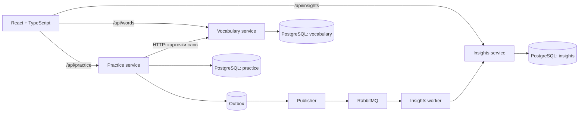

# Wordwell

Локальное приложение для изучения английских слов. Словарь пополняется вручную или JSON-файлом, тренировка предлагает перевод в обе стороны, а интервалы повторения зависят от ответов.

## Запуск

Нужны Docker с Compose и `make` (в WSL они уже доступны). Из корня репозитория:

```bash
cp .env.example .env
make up
```

`make up` поднимет PostgreSQL и RabbitMQ, соберёт образы, применит Alembic-миграции ко всем базам, запустит сервисы и дождётся их healthcheck. После успешного запуска команда напечатает фактический адрес фронтенда. По умолчанию это [http://localhost:8080](http://localhost:8080). Данные PostgreSQL сохраняются в Docker volume `postgres_data`.

Для остановки: `make down`. Эта команда сохраняет слова. `docker compose down -v` **удалит** базу; перед этим скачай JSON через кнопку «Экспорт» в словаре.

Дополнительные адреса только на этом компьютере: Swagger словаря — `http://localhost:8001/docs`, тренировок — `http://localhost:8002/docs`, статистики — `http://localhost:8003/docs`; RabbitMQ UI — `http://localhost:15672` (учётные данные из `.env`).

## Как добавить слова

1. Скопируй [промпт](frontend/public/word-prompt.md), вставь в него список слов и отправь любой выбранной тобой нейросети. Само приложение к нейросети не подключается.
2. Сохрани полученный ответ в UTF-8 файл с расширением `.json`.
3. Открой «Импорт слов» в приложении и загрузи файл. [Пример файла](frontend/public/example-words.json) можно импортировать для проверки.

Корень файла — массив объектов или объект `{"words": [...]}`. Обязательные поля каждого слова: `english` и непустой массив `translations`. Необязательные: `examples` (`en`/`ru`), `part_of_speech`, `note`, `tags`. Повторный импорт слова с тем же английским написанием обновляет его карточку. Импорт целиком проверяется перед записью; частично корректные файлы не создают частичный словарь. Лимит — 2 МБ.

В словаре также можно добавлять, менять и удалять слова вручную, редактировать несколько примеров, выставлять степень изученности отдельно для двух направлений и скачивать JSON для резервной копии.

## Архитектура



Каждый сервис владеет своей базой, хотя все три базы работают в одном контейнере PostgreSQL. Миграция `shared/alembic/bootstrap` создаёт базы, а миграции внутри каждого сервиса создают таблицы. Старые локальные базы первого MVP миграции принимают без удаления таблиц и данных. Практика получает карточки слов через API словаря и синхронно сохраняет результат и текущий уровень. Событие ответа записывается в outbox в той же транзакции, затем отдельный publisher доставляет его в RabbitMQ. Worker статистики обрабатывает событие с защитой от дубликатов. Это позволяет позднее добавлять новые виды упражнений и подписчиков на события без общей таблицы между сервисами. Статистика на главной странице может обновиться с небольшой задержкой.

В каждом `services/<name>/src` HTTP-маршруты лежат в `api`, предметная логика — в `services`, доступ к собственной базе — в `repositories`, таблицы — в `models.py`, входные и выходные схемы — в Pydantic-моделях. В `shared` находятся общие настройки, контракты событий и слов, обработка ошибок, соединения с БД и RabbitMQ. У фронтенда отдельные папки для страниц, компонентов, API и стилей.

Текущий алгоритм: для каждого слова отдельно хранятся уровни EN→RU и RU→EN. Верный ответ повышает уровень (до 6) и назначает повторение через 1, 3, 7, 14, 30 или 60 дней. Ошибка сбрасывает уровень и делает карточку доступной сразу. При выборе слова новые и просроченные карточки получают больший вес, выученные — меньший. Даже освоенные слова иногда могут встретиться. Сравнение ответа игнорирует регистр, пунктуацию и разницу «е/ё», но не проверяет свободные формулировки по смыслу.

## API

| Сервис | Основные ручки |
| --- | --- |
| Vocabulary | `GET/POST /words`, `GET/PUT/DELETE /words/{id}`, `POST /words/import` (multipart file), `GET /words/export` |
| Practice | `GET /practice/next?direction=en_ru\|ru_en`, `POST /practice/answer`, `GET /practice/progress`, `PUT /practice/progress/{word_id}`, `GET /practice/summary` |
| Insights | `GET /insights/summary` |

Все API доступны через один адрес приложения с префиксом `/api`, например `http://localhost:8080/api/words`. Swagger открыт на прямых локальных портах.

## Разработка

Для фронтенда нужен Node.js 20+: `cd frontend && npm ci && npm run dev`; Vite доступен на `http://localhost:5173` и проксирует запросы к сервисам в Compose. Проверка сборки: `npm run build`. Для контейнеров: `docker compose ps` и `make logs`.

Зависимости Python заданы в `requirements.in` и зафиксированы вместе с транзитивными версиями в `requirements.txt` через `pip-compile`. Для обновления: `python3.12 -m venv .venv && .venv/bin/pip install -r requirements-dev.txt`, затем `make lock` и `make lock-dev`. Проверки: `make check` (pre-commit, Ruff, YAML/JSON/TOML и пробелы). `make migrate` повторно применяет миграции. Новую миграцию для конкретного сервиса можно создать командой `docker compose run --rm <service> alembic -c services/<service>/alembic.ini revision --autogenerate -m "описание"`, затем проверить сгенерированный код перед применением.

В MVP нет аккаунтов: сервисы и данные рассчитаны на одного пользователя ноутбука. Порты привязаны к `127.0.0.1`. Схема базы меняется только миграциями; перед серьёзными изменениями следует сохранить резервную копию volume PostgreSQL. Ограничение выдачи слов в учебном сервисе сейчас 10 000 карточек, что достаточно для личного словаря, но для более крупного объёма нужно постраничное чтение.

## Что добавить дальше

- Несколько допустимых английских форм и контекстные значения слова: сейчас английский ответ сравнивается со словарной формой, а русский — с указанными переводами.
- Кнопку «Я знал, но опечатался», чтобы случайная ошибка не обнуляла интервал.
- Режим практики только просроченных карточек и дневную цель на 10–20 ответов.
- Произношение через локальный TTS и упражнения на аудирование без внешнего ML.
- Экспорт и восстановление не только слов, но и истории повторений.
